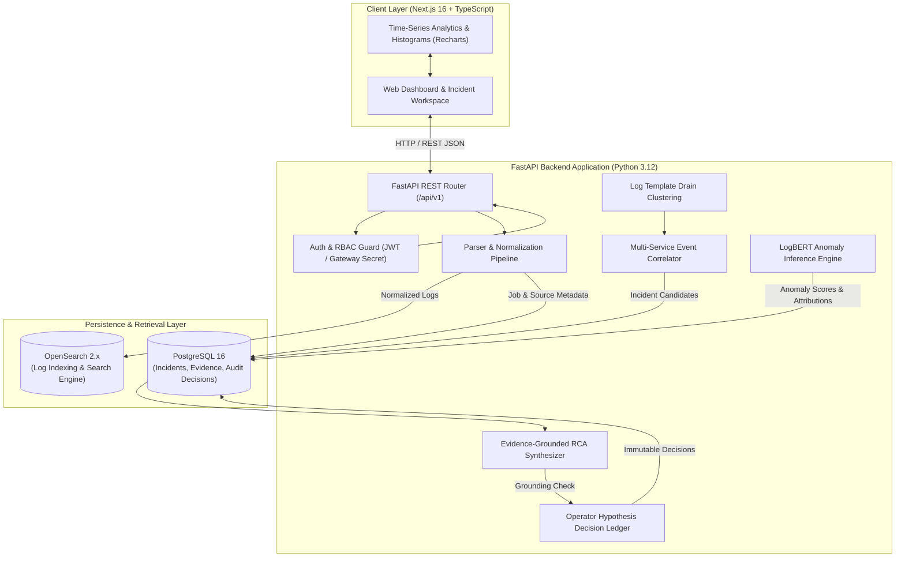
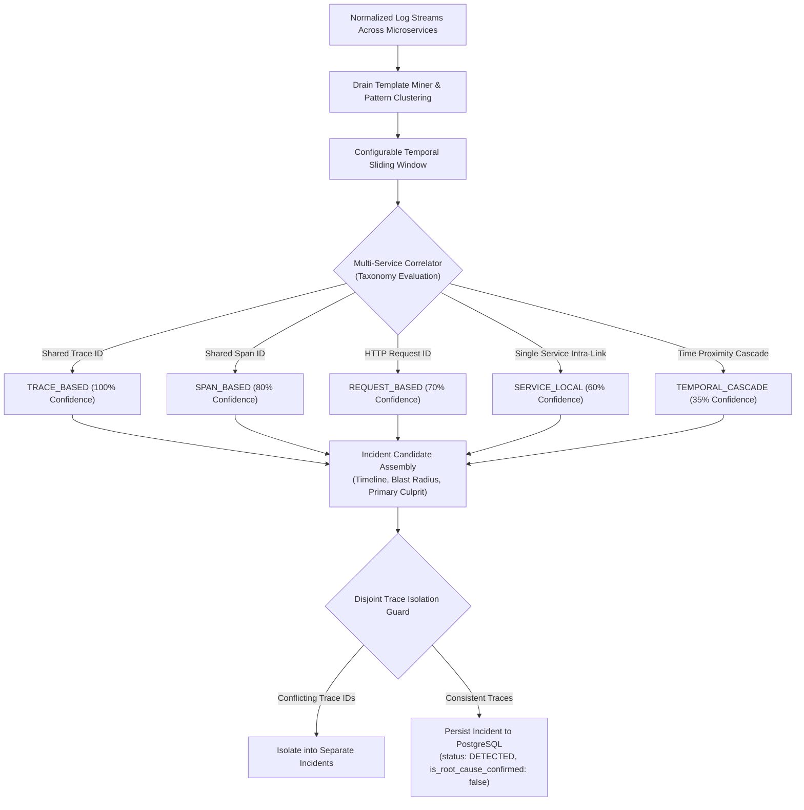
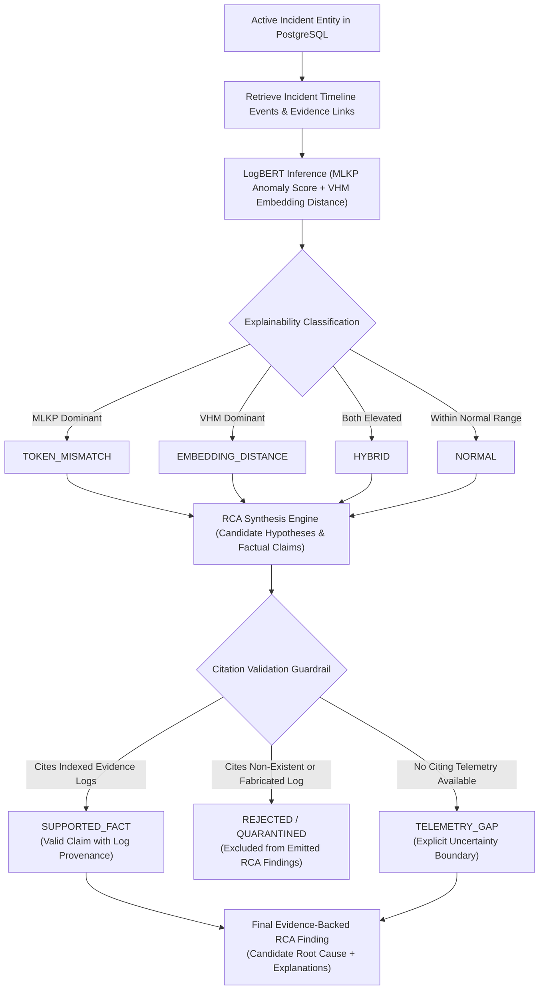
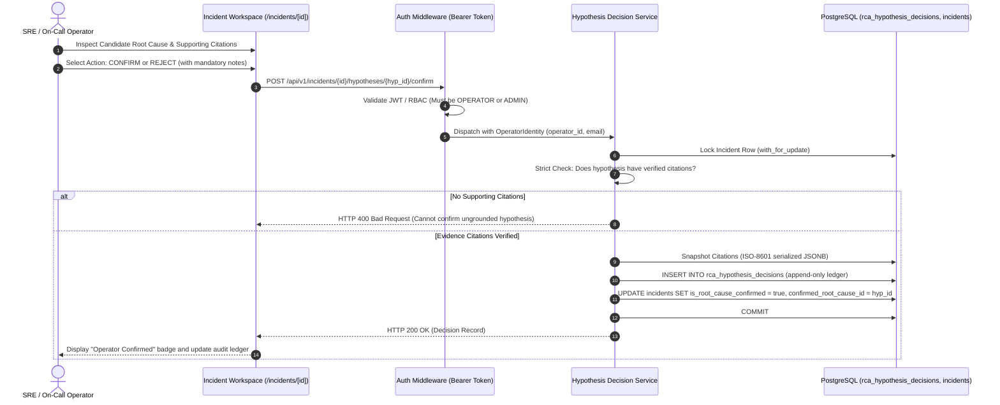

# RootLens — System Architecture Specification

## 1. System Overview

**RootLens** is an AI-powered enterprise log intelligence and root cause analysis (RCA) platform designed to ingest, normalize, and index high-volume distributed logs, isolate anomalous failure cascades, construct deterministic evidence graphs, and generate evidence-grounded incident explanations.

RootLens pairs a Python/FastAPI backend with a Next.js/TypeScript frontend, backed by PostgreSQL for metadata and OpenSearch for high-speed log search.

---

## 2. Frozen Technology Stack

| Layer | Component | Technology | Role / Responsibility |
| :--- | :--- | :--- | :--- |
| **Frontend** | User Interface | **Next.js (App Router), TypeScript, Tailwind CSS** | Interactive web dashboard for log exploration, filtering, timeline inspection, and RCA reports |
| **Frontend** | Visualizations | **Recharts** | Interactive time-series log volume charts, error spike histograms, and metric distributions |
| **Backend** | API & Core Logic | **Python, FastAPI** | REST APIs, log ingestion/parsing pipeline, anomaly detection, incident orchestrator, RCA service |
| **Backend** | Auth & Security | **PyJWT (HS256) + Gateway Secret** | Cryptographic session verification, RBAC permissions, and trusted gateway mutual auth |
| **Storage** | Application DB | **PostgreSQL 16+** | Relational storage for application metadata, incident records, run configurations, and audit ledgers |
| **Storage** | Search & Indexing | **OpenSearch 2.x** | Distributed search engine for indexing, full-text searching, log filtering, and time-series aggregations |
| **AI / ML** | Anomaly Scoring | **PyTorch + LogBERT** | 4-layer transformer for Masked Log Key Prediction (MLKP) and Vector Health Metric (VHM) scoring |
| **AI / NLP** | Embeddings | **Sentence Transformers** | Log template embedding generation for semantic search and log pattern clustering |
| **AI / NLP** | Explanation LLM | **Llama-family model** (Local/Self-hosted) | Grounded natural language explanation and synthesis strictly derived from deterministic evidence graphs |

---

## 3. High-Level Architectural Diagram



---

## 4. End-to-End System Workflow Diagrams

### 4.1 Log Ingestion & Normalization Flow

```mermaid
sequenceDiagram
    autonumber
    actor Client as Client / Shipper
    participant API as Ingestion Endpoint (/api/v1/logs/upload)
    participant Disk as Staging Storage (data/uploads/)
    participant Parser as Parsing Service
    participant Normalizer as Normalization Service
    participant PG as PostgreSQL (log_sources, upload_jobs)
    participant OS as OpenSearch (rootlens-logs-*)

    Client->>API: POST /api/v1/logs/upload (multipart file)
    API->>Disk: Stream file to disk (UUID-named staging)
    API->>PG: INSERT log_source & upload_job (PENDING)
    API-->>Client: HTTP 201 Created (job_id, source_id)

    Client->>API: POST /api/v1/logs/jobs/{job_id}/parse
    API->>Parser: Parse file from disk (JSON / Grok / Syslog)
    Parser->>PG: UPDATE upload_job (status=PARSED, total_lines)
    API-->>Client: HTTP 200 OK (parsed count)

    Client->>API: POST /api/v1/logs/jobs/{job_id}/normalize
    API->>Normalizer: Normalize timestamps to UTC ISO-8601, map log levels
    Normalizer->>PG: UPDATE upload_job (status=COMPLETED)
    Normalizer->>OS: Bulk index documents (if OS available; fallback gracefully)
    API-->>Client: HTTP 200 OK (valid normalized records)
```

---

### 4.2 Multi-Service Event Correlation & Incident Creation Flow



---

### 4.3 Evidence-Grounded RCA Flow



---

### 4.4 Human Operator Decision & Audit Ledger Workflow



---

## 5. Scope Constraints & Non-Goals

To maintain a disciplined, high-quality enterprise capstone architecture:
- ❌ **No Automated Remediation**: The platform informs, explains, and guides human operators; it does not execute automated server mutations or code rollbacks.
- ❌ **No Multi-Tenant SaaS Sharding**: The platform is an internal enterprise single-tenant platform. Multi-tenancy is handled via independent deployment stacks.
- ❌ **No Heavy Message Brokers**: Synchronous streaming and batch upload endpoints fulfill all throughput requirements without the operational burden of Apache Kafka or RabbitMQ.
