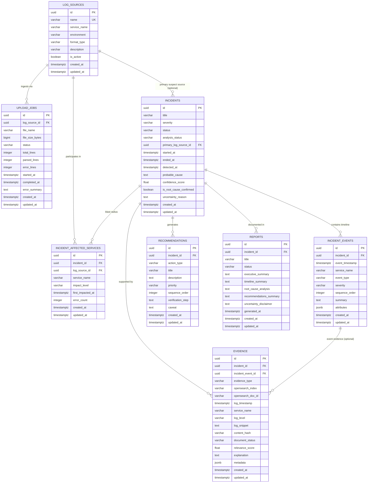

# RootLens — PostgreSQL Data Model Specification

## 1. Architectural Context & Dual-Storage Boundaries

RootLens employs a **dual-storage architecture** as formalized in [docs/engineering-decisions.md](file:///d:/RootLens/docs/engineering-decisions.md) (Decision 1):

1. **OpenSearch (Event & Search Layer)**: Indexes, searches, and aggregates high-throughput, semi-structured log events.
2. **PostgreSQL (Metadata & State Layer)**: Stores relational application entities, ingestion job states, incident definitions, deterministic evidence pointers, blast-radius mappings, recommendations, and synthesized post-mortem reports.

### The Storage Boundary Rule
> **Zero Raw Log Duplication**: PostgreSQL **never** ingests or duplicates full raw log streams. Instead, PostgreSQL entities maintain precise search-pointer references (`opensearch_index`, `opensearch_doc_id`, `log_timestamp`) accompanied by immutable bounded excerpts (`log_snippet`) and content hashes for verifiable, offline-durable presentation.

---

## 2. Design Conventions & Standards

To ensure consistency, maintainability, and clean database engineering, all tables follow these conventions:

- **Naming**: `snake_case` for all table names (pluralized, e.g., `log_sources`, `incidents`, `incident_affected_services`) and column names.
- **Primary Keys**: UUIDv4 (`UUID` in PostgreSQL, default `gen_random_uuid()`).
- **Foreign Keys**: Named `<singular_parent>_id` with explicit `REFERENCES` and justified `ON DELETE` constraints (`CASCADE` for incident-owned detail rows, `RESTRICT` for referenced configuration data, `SET NULL` for optional references).
- **Audit Timestamps**: All entities carry `created_at TIMESTAMPTZ NOT NULL DEFAULT NOW()` and `updated_at TIMESTAMPTZ NOT NULL DEFAULT NOW()`.
- **Domain Timestamps**: All timeline dates carry timezone awareness (`TIMESTAMPTZ`).
- **Nullability**: Explicitly defined for every column. Optional descriptive text or unresolved states are nullable; state flags, IDs, and timestamps are required.
- **Enums vs. Varchar Constraints**: State fields use `VARCHAR` with explicit `CHECK` constraints to ensure schema flexibility while enforcing valid domain states.

---

## 3. Entity-Relationship (ER) Diagram



---

## 4. Assessment: User Entity in the Initial Prototype

### Evaluation
The objective of RootLens in Phase 02 is building a robust log ingestion, search, and deterministic root-cause analysis platform.

| Consideration | Impact on Initial Prototype | Recommendation |
| :--- | :--- | :--- |
| **Authentication Scope** | Adding a full `users` table requires password hashing, token validation (JWT/OAuth), session management, and role-based access control (RBAC). | **Out of Scope** for initial prototype. |
| **Audit Trails** | Need to know who triggered an analysis or updated incident status. | Can be captured via simple string identifiers (`operator_tag` or `created_by` defaulting to `"system"`) without relational coupling. |
| **Development Velocity** | Coupling database migrations to user authentication prematurely complicates local developer setup and testing pipelines. | Keep initial API unauthenticated on localhost. |

### Architectural Decision
- **No `users` table in the initial prototype.**
- Field audit references will use optional text attributes (`created_by VARCHAR(100) DEFAULT 'system'`) on user-facing modifications (e.g., reports, incident overrides).
- A full `User` and `Role` entity will be evaluated in a future phase (e.g., Phase 17/18) when team-level collaboration and access controls are required.

---

## 5. Detailed Entity Specifications

### 5.1 `log_sources`
Represents an origin of log streams (a microservice, database server, background worker, or ingress controller).

- **Purpose**: Defines configuration, parsing formats, and operational environments for incoming log data.
- **Constraints & Indexes**:
  - Primary Key: `id` (UUID)
  - Unique Constraint: `uq_log_sources_name_env` on `(name, environment)`
  - Index: `idx_log_sources_service_env` on `(service_name, environment)`

| Column | Type | Nullable | Default | Description |
| :--- | :--- | :--- | :--- | :--- |
| `id` | `UUID` | **NO** | `gen_random_uuid()` | Unique source identifier |
| `name` | `VARCHAR(100)` | **NO** | — | Human-readable source name (e.g., `checkout-service-prod`) |
| `service_name` | `VARCHAR(100)` | **NO** | — | Normalized service identifier (e.g., `checkout-service`) |
| `environment` | `VARCHAR(50)` | **NO** | `'production'` | Deployment environment (`production`, `staging`, `development`) |
| `format_type` | `VARCHAR(50)` | **NO** | `'json'` | Expected log format: `json`, `syslog`, `grok`, `unstructured` |
| `description` | `TEXT` | YES | `NULL` | Optional description of source architecture and role |
| `is_active` | `BOOLEAN` | **NO** | `TRUE` | Whether this source is actively ingesting data |
| `created_at` | `TIMESTAMPTZ` | **NO** | `NOW()` | Timestamp of source creation |
| `updated_at` | `TIMESTAMPTZ` | **NO** | `NOW()` | Timestamp of last metadata update |

---

### 5.2 `upload_jobs`
Tracks batches of log data ingested from files or API uploads.

- **Purpose**: Provides auditability, processing throughput metrics, and error quarantine tracking for log ingestion runs.
- **Lifecycle / Status Values**:
  - `PENDING`: Upload received; waiting in ingestion queue.
  - `PROCESSING`: File being read, parsed, normalized, and streamed to OpenSearch.
  - `COMPLETED`: Ingestion completed without fatal errors.
  - `FAILED`: Parsing or indexing failed catastrophically.
  - `PARTIALLY_FAILED`: Job finished, but some malformed lines were quarantined.
- **Constraints & Indexes**:
  - Primary Key: `id` (UUID)
  - Foreign Key: `log_source_id` -> `log_sources(id)` `ON DELETE RESTRICT` (prevents deleting active log sources with existing upload job history)
  - Index: `idx_upload_jobs_status_created` on `(status, created_at DESC)`
  - Index: `idx_upload_jobs_source` on `(log_source_id)`

| Column | Type | Nullable | Default | Description |
| :--- | :--- | :--- | :--- | :--- |
| `id` | `UUID` | **NO** | `gen_random_uuid()` | Unique ingestion job identifier |
| `log_source_id` | `UUID` | **NO** | — | Associated log source |
| `file_name` | `VARCHAR(255)` | **NO** | — | Name of uploaded file or stream batch identifier |
| `file_size_bytes` | `BIGINT` | **NO** | `0` | File size in bytes |
| `status` | `VARCHAR(30)` | **NO** | `'PENDING'` | Ingestion lifecycle status |
| `total_lines` | `INTEGER` | **NO** | `0` | Total log lines parsed |
| `parsed_lines` | `INTEGER` | **NO** | `0` | Successfully normalized and indexed lines |
| `error_lines` | `INTEGER` | **NO** | `0` | Malformed or quarantined lines |
| `started_at` | `TIMESTAMPTZ` | YES | `NULL` | Timestamp ingestion started |
| `completed_at` | `TIMESTAMPTZ` | YES | `NULL` | Timestamp ingestion finished |
| `error_summary` | `TEXT` | YES | `NULL` | Error messages if job failed or lines were dropped |
| `created_at` | `TIMESTAMPTZ` | **NO** | `NOW()` | Ingestion record creation timestamp |
| `updated_at` | `TIMESTAMPTZ` | **NO** | `NOW()` | Ingestion record update timestamp |

---

### 5.3 `incidents`
Represents an identified anomalous cluster, outage, or performance degradation event across one or more services.

- **Purpose**: Central hub for root-cause analysis, anomaly boundaries, confidence scoring, and investigation status.
- **Distinguishing Primary Suspect Source from Affected Services**:
  - `primary_log_source_id`: Designates the **hypothesized or verified trigger origin** (e.g., PostgreSQL connection pool exhaustion on the database service). Can be `NULL` if multi-service ambiguity prevents isolating a single initial culprit.
  - Multi-service impact and blast radius are captured relationally via `incident_affected_services`.
- **Incident Operational Status (`status`) Values**:
  - `DETECTED`: Anomaly isolated by statistical engine or manual operator trigger.
  - `INVESTIGATING`: Analysis engine actively collecting timeline and evidence.
  - `IDENTIFIED`: Probable cause formulated with supporting evidence.
  - `RESOLVED`: Incident mitigated or closed.
  - `FALSE_POSITIVE`: Anomaly determined to be benign operational noise.
- **Analysis State (`analysis_status`) Values**:
  - `PENDING`: Analysis not yet initiated.
  - `IN_PROGRESS`: Correlating logs and building evidence graph.
  - `EVALUATED_CERTAIN`: Analysis meets the system's defined internal evidence criteria (e.g., temporal lead, anomaly threshold, dependency link, complete logs); reflects algorithmic criterion satisfaction under available telemetry, NOT that the root cause is objectively proven.
  - `EVALUATED_UNCERTAIN`: High ambiguity, conflicting signals, or inconclusive correlation; root cause cannot be confirmed algorithmically.
  - `INSUFFICIENT_DATA`: Missing log windows, unindexed intervals, or telemetry gaps prevent conclusive diagnosis.
- **Severity Values**:
  - `CRITICAL`: P0 outage, complete service degradation.
  - `HIGH`: P1 issue, significant errors or downstream cascade.
  - `MEDIUM`: P2 issue, elevated error rates or localized failure.
  - `LOW`: P3 issue, isolated warning surges or non-critical anomaly.
- **Constraints & Indexes**:
  - Primary Key: `id` (UUID)
  - Foreign Key: `primary_log_source_id` -> `log_sources(id)` `ON DELETE SET NULL`
  - Index: `idx_incidents_status_severity` on `(status, severity)`
  - Index: `idx_incidents_timeline` on `(started_at, ended_at)`
  - Index: `idx_incidents_analysis_status` on `(analysis_status)`

| Column | Type | Nullable | Default | Description |
| :--- | :--- | :--- | :--- | :--- |
| `id` | `UUID` | **NO** | `gen_random_uuid()` | Unique incident identifier |
| `title` | `VARCHAR(255)` | **NO** | — | Concise incident summary (e.g., `Cascading 504 Gateway Timeouts`) |
| `severity` | `VARCHAR(20)` | **NO** | `'MEDIUM'` | Incident severity level |
| `status` | `VARCHAR(30)` | **NO** | `'DETECTED'` | Operational lifecycle status |
| `analysis_status` | `VARCHAR(30)` | **NO** | `'PENDING'` | Automated RCA diagnostic status |
| `primary_log_source_id` | `UUID` | YES | `NULL` | Primary suspect or origin service (if identifiable) |
| `started_at` | `TIMESTAMPTZ` | **NO** | — | Timestamp of earliest detected anomalous event |
| `ended_at` | `TIMESTAMPTZ` | YES | `NULL` | Timestamp of recovery or boundary end |
| `detected_at` | `TIMESTAMPTZ` | **NO** | `NOW()` | Timestamp incident was registered by system |
| `probable_cause` | `TEXT` | YES | `NULL` | Formulated root-cause hypothesis (null if uncertain) |
| `confidence_score` | `FLOAT` | **NO** | `0.0` | Heuristic composite diagnostic index (0.00 to 1.00) |
| `is_root_cause_confirmed` | `BOOLEAN` | **NO** | `FALSE` | Explicit verification flag (human operator confirmation or external ground-truth validation; NEVER set automatically by confidence score thresholds alone) |
| `uncertainty_reason` | `TEXT` | YES | `NULL` | Explicit explanation when analysis is uncertain or telemetry is missing |
| `created_at` | `TIMESTAMPTZ` | **NO** | `NOW()` | Record creation timestamp |
| `updated_at` | `TIMESTAMPTZ` | **NO** | `NOW()` | Record update timestamp |

---

### 5.4 `incident_affected_services`
Associative relation linking an incident to all participating services across the distributed failure cascade (blast radius).

- **Purpose**: Solves multi-service incident tracking by capturing every affected service, its impact role, first impact timestamp, and error volume.
- **Impact Level (`impact_level`) Values**:
  - `PRIMARY_CULPRIT`: The upstream service originating the failure.
  - `DOWNSTREAM_CASCADE`: Service failing as a consequence of upstream dependencies.
  - `CORRELATED_ANOMALY`: Service exhibiting co-occurring anomalies without direct verified causal link.
- **Constraints & Indexes**:
  - Primary Key: `id` (UUID)
  - Foreign Key: `incident_id` -> `incidents(id)` `ON DELETE CASCADE`
  - Foreign Key: `log_source_id` -> `log_sources(id)` `ON DELETE RESTRICT`
  - Unique Constraint: `uq_incident_affected_services` on `(incident_id, log_source_id)` (prevents duplicate service mappings per incident)
  - Index: `idx_affected_services_incident` on `(incident_id)`
  - Index: `idx_affected_services_source` on `(log_source_id)`
  - Index: `idx_affected_services_name` on `(service_name)`

| Column | Type | Nullable | Default | Description |
| :--- | :--- | :--- | :--- | :--- |
| `id` | `UUID` | **NO** | `gen_random_uuid()` | Unique blast-radius record identifier |
| `incident_id` | `UUID` | **NO** | — | Associated incident |
| `log_source_id` | `UUID` | **NO** | — | Associated log source |
| `service_name` | `VARCHAR(100)` | **NO** | — | Denormalized service name for fast display |
| `impact_level` | `VARCHAR(30)` | **NO** | `'DOWNSTREAM_CASCADE'` | Role in the failure cascade |
| `first_impacted_at` | `TIMESTAMPTZ` | **NO** | — | Earliest error timestamp for this service in incident |
| `error_count` | `INTEGER` | **NO** | `0` | Number of error/fatal logs recorded in incident window |
| `created_at` | `TIMESTAMPTZ` | **NO** | `NOW()` | Record creation timestamp |
| `updated_at` | `TIMESTAMPTZ` | **NO** | `NOW()` | Record update timestamp |

---

### 5.5 `incident_events`
Chronological milestones and significant anomaly events constituting the incident timeline.

- **Purpose**: Tracks the temporal propagation of failures (e.g., database connection pool full -> auth service latency -> API gateway 504 timeouts).
- **Event Type (`event_type`) Values**:
  - `ANOMALY_SPIKE`: Statistical frequency spike in log messages.
  - `FIRST_ERROR`: Earliest observed fatal or error log in the anomaly window.
  - `CASCADING_FAILURE`: Downstream service error triggered by upstream fault.
  - `RETRY_STORM`: High-frequency client or service retry surge.
  - `RECOVERY`: Error rate returned to baseline.
- **Constraints & Indexes**:
  - Primary Key: `id` (UUID)
  - Foreign Key: `incident_id` -> `incidents(id)` `ON DELETE CASCADE`
  - Unique Constraint: `uq_incident_event_sequence` on `(incident_id, sequence_order)` (enforces strict ordering)
  - Index: `idx_incident_events_timeline` on `(incident_id, event_timestamp ASC)`
  - Index: `idx_incident_events_service` on `(service_name, event_timestamp)`

| Column | Type | Nullable | Default | Description |
| :--- | :--- | :--- | :--- | :--- |
| `id` | `UUID` | **NO** | `gen_random_uuid()` | Unique timeline event identifier |
| `incident_id` | `UUID` | **NO** | — | Associated incident |
| `event_timestamp` | `TIMESTAMPTZ` | **NO** | — | Timestamp when event occurred |
| `service_name` | `VARCHAR(100)` | **NO** | — | Affected service name |
| `event_type` | `VARCHAR(50)` | **NO** | `'ANOMALY_SPIKE'` | Classification of timeline milestone |
| `severity` | `VARCHAR(20)` | **NO** | `'INFO'` | Severity of this specific event |
| `sequence_order` | `INTEGER` | **NO** | `0` | Chronological sort order index |
| `summary` | `TEXT` | **NO** | — | Concise description of the event |
| `attributes` | `JSONB` | **NO** | `'{}'::jsonb` | Flexible key-value metrics (e.g., `error_rate: 45.2`, `z_score: 4.8`) |
| `created_at` | `TIMESTAMPTZ` | **NO** | `NOW()` | Creation timestamp |
| `updated_at` | `TIMESTAMPTZ` | **NO** | `NOW()` | Update timestamp |

---

### 5.6 `evidence`
Concrete, verifiable pieces of evidence pointing to specific log events or statistical facts supporting the RCA diagnosis.

- **Purpose**: Implements Decision 3 and Decision 4 by grounding all RCA conclusions in verifiable evidence pointers without copying entire raw logs.
- **Evidence Type (`evidence_type`) Values**:
  - `CULPRIT_LOG`: Direct culprit error line (e.g., `Connection refused: postgres:5432`).
  - `CORRELATION_SPIKE`: Statistical co-occurrence of errors across two services.
  - `LATENCY_THRESHOLD`: Response time anomaly associated with failure.
  - `TEMPLATE_ANOMALY`: Novel or unseen log template detected during window.
- **Document Availability Status (`document_status`) Values**:
  - `INDEXED`: Document is verified present and queryable in OpenSearch.
  - `ROTATED_OUT`: Document index has aged out according to retention policy; fallback snippet preserved.
  - `UNREACHABLE`: OpenSearch cluster or index is temporarily unavailable.
  - `MANUALLY_CAPTURED`: Operator-pinned evidence line captured during triage.
- **Constraints & Indexes**:
  - Primary Key: `id` (UUID)
  - Foreign Key: `incident_id` -> `incidents(id)` `ON DELETE CASCADE`
  - Foreign Key: `incident_event_id` -> `incident_events(id)` `ON DELETE SET NULL`
  - Index: `idx_evidence_incident_relevance` on `(incident_id, relevance_score DESC)`
  - Index: `idx_evidence_os_pointer` on `(opensearch_index, opensearch_doc_id)`

| Column | Type | Nullable | Default | Description |
| :--- | :--- | :--- | :--- | :--- |
| `id` | `UUID` | **NO** | `gen_random_uuid()` | Unique evidence item identifier |
| `incident_id` | `UUID` | **NO** | — | Associated incident |
| `incident_event_id` | `UUID` | YES | `NULL` | Optional link to specific milestone event |
| `evidence_type` | `VARCHAR(50)` | **NO** | `'CULPRIT_LOG'` | Classification of evidence |
| `opensearch_index` | `VARCHAR(100)` | YES | `NULL` | OpenSearch index name containing target log |
| `opensearch_doc_id` | `VARCHAR(100)` | YES | `NULL` | Document `_id` in OpenSearch for direct retrieval |
| `log_timestamp` | `TIMESTAMPTZ` | YES | `NULL` | Timestamp of the indexed log entry |
| `service_name` | `VARCHAR(100)` | YES | `NULL` | Service that emitted the log |
| `log_level` | `VARCHAR(20)` | YES | `NULL` | Severity level of log (`ERROR`, `FATAL`, etc.) |
| `log_snippet` | `TEXT` | YES | `NULL` | Bounded excerpt of message (max 1000 chars) |
| `content_hash` | `VARCHAR(64)` | YES | `NULL` | SHA-256 hash of original raw log entry for tamper-evident provenance |
| `document_status` | `VARCHAR(30)` | **NO** | `'INDEXED'` | Availability status of OpenSearch source document |
| `relevance_score` | `FLOAT` | **NO** | `1.0` | Weight of evidence in causality determination (0.0 - 1.0) |
| `explanation` | `TEXT` | **NO** | — | Why this evidence supports the diagnosis |
| `metadata` | `JSONB` | **NO** | `'{}'::jsonb` | Additional diagnostic details (e.g. stack trace frame, template ID) |
| `created_at` | `TIMESTAMPTZ` | **NO** | `NOW()` | Creation timestamp |
| `updated_at` | `TIMESTAMPTZ` | **NO** | `NOW()` | Update timestamp |

---

### 5.7 `recommendations`
Actionable diagnostic, remediation, or preventative measures associated with an incident.

- **Purpose**: Translates root-cause insights into operator guidance. Contains explicit caveats and uncertainty disclaimers.
- **Action Type (`action_type`) Values**:
  - `IMMEDIATE_ACTION`: Mitigation step for ongoing incident (e.g., restart service, increase pool size).
  - `CONFIG_CHANGE`: Recommended permanent configuration update.
  - `CODE_FIX`: Recommended bug fix or error-handling patch.
  - `MONITORING_ALERT`: Recommended new alert rule to detect early recurrence.
- **Priority Values**:
  - `CRITICAL`, `HIGH`, `MEDIUM`, `LOW`.
- **Constraints & Indexes**:
  - Primary Key: `id` (UUID)
  - Foreign Key: `incident_id` -> `incidents(id)` `ON DELETE CASCADE`
  - Index: `idx_recommendations_incident_priority` on `(incident_id, priority)`

| Column | Type | Nullable | Default | Description |
| :--- | :--- | :--- | :--- | :--- |
| `id` | `UUID` | **NO** | `gen_random_uuid()` | Unique recommendation identifier |
| `incident_id` | `UUID` | **NO** | — | Associated incident |
| `action_type` | `VARCHAR(50)` | **NO** | `'IMMEDIATE_ACTION'` | Categorization of recommendation |
| `title` | `VARCHAR(255)` | **NO** | — | Concise action heading |
| `description` | `TEXT` | **NO** | — | Detailed explanation of recommended step |
| `priority` | `VARCHAR(20)` | **NO** | `'MEDIUM'` | Urgency ranking |
| `sequence_order` | `INTEGER` | **NO** | `0` | Recommended execution sequence |
| `verification_step` | `TEXT` | YES | `NULL` | How the engineer can verify the remedy succeeded |
| `caveat` | `TEXT` | YES | `NULL` | Explicit risks, side effects, or uncertainty disclaimers |
| `created_at` | `TIMESTAMPTZ` | **NO** | `NOW()` | Creation timestamp |
| `updated_at` | `TIMESTAMPTZ` | **NO** | `NOW()` | Update timestamp |

---

### 5.8 `reports`
Formal, printable Post-Mortem / RCA investigation document synthesized from the incident, timeline events, evidence, and LLM explanation.

- **Purpose**: Serves as the persistent, shareable output of an investigation for SRE records.
- **Report Status (`status`) Values**:
  - `DRAFT`: Automated report generated; pending engineer review.
  - `FINAL`: Reviewed and accepted post-mortem.
  - `EXPORTED`: Downloaded or shared as Markdown/PDF.
- **Constraints & Indexes**:
  - Primary Key: `id` (UUID)
  - Foreign Key: `incident_id` -> `incidents(id)` `ON DELETE CASCADE`
  - Unique Constraint: `uq_reports_incident_title` on `(incident_id, title)`
  - Index: `idx_reports_incident_generated` on `(incident_id, generated_at DESC)`
  - Index: `idx_reports_status` on `(status)`

| Column | Type | Nullable | Default | Description |
| :--- | :--- | :--- | :--- | :--- |
| `id` | `UUID` | **NO** | `gen_random_uuid()` | Unique report identifier |
| `incident_id` | `UUID` | **NO** | — | Associated incident |
| `title` | `VARCHAR(255)` | **NO** | — | Report title (e.g., `Post-Mortem: Incident INC-2026-10-09-01`) |
| `status` | `VARCHAR(30)` | **NO** | `'DRAFT'` | Report approval status |
| `executive_summary` | `TEXT` | **NO** | — | High-level non-technical summary |
| `timeline_summary` | `TEXT` | **NO** | — | Markdown-formatted timeline narrative |
| `root_cause_analysis` | `TEXT` | **NO** | — | Evidence-grounded root-cause narrative |
| `recommendations_summary` | `TEXT` | **NO** | — | Actionable remediation guidelines |
| `uncertainty_disclaimer` | `TEXT` | YES | `NULL` | Mandatory disclaimer when evidence is incomplete |
| `generated_at` | `TIMESTAMPTZ` | **NO** | `NOW()` | Generation timestamp |
| `created_at` | `TIMESTAMPTZ` | **NO** | `NOW()` | Record creation timestamp |
| `updated_at` | `TIMESTAMPTZ` | **NO** | `NOW()` | Record update timestamp |

---

## 6. OpenSearch Linkage, Traceability & Unavailable-Document Protocol

A fundamental design requirement is linking PostgreSQL relational records to OpenSearch documents without replicating bulk logs, while guaranteeing that offline reports and expired indices never corrupt the investigation trail:

```
┌────────────────────────────────────────────────────────┐
│           PostgreSQL: evidence table record            │
│ ────────────────────────────────────────────────────── │
│ id:                "c4b2a8d1-..."                      │
│ incident_id:       "98f12a34-..."                      │
│ evidence_type:     "CULPRIT_LOG"                       │
│ opensearch_index:  "rootlens-logs-2026.10"             │
│ opensearch_doc_id: "os-doc-89a712bc"                   │ ──┐ Primary Live Pointer
│ log_timestamp:     "2026-10-09T14:02:18.124Z"          │   │
│ log_snippet:       "Connection pool exhausted (0/20)..."│   │ (Immutable Excerpt)
│ content_hash:      "e3b0c44298fc1c149afbf4c8996fb924..."│   │ (SHA-256 Checksum)
│ document_status:   "INDEXED"                           │   │
│ relevance_score:   0.95                                │   │
└────────────────────────────────────────────────────────┘   │
                                                             ▼
┌────────────────────────────────────────────────────────┐
│         OpenSearch: Full Raw Indexed Document          │
│ ────────────────────────────────────────────────────── │
│ _index: "rootlens-logs-2026.10"                        │
│ _id:    "os-doc-89a712bc"                              │
│ _source: {                                             │
│    "timestamp": "2026-10-09T14:02:18.124Z",            │
│    "service": "billing-service",                       │
│    "level": "FATAL",                                   │
│    "message": "Connection pool exhausted (0/20)...",   │
│    "stack_trace": "org.postgresql.util.PSQLException...",│
│    "host": "prod-billing-worker-02",                   │
│    "trace_id": "tr-4a81b9921",                         │
│    "span_id": "sp-9901"                                │
│ }                                                      │
└────────────────────────────────────────────────────────┘
```

### Traceability Protocol
1. **Immutable Excerpting**: When an anomaly or culprit log is isolated, the analysis engine writes the first 1,000 characters of the log into `log_snippet` and generates a SHA-256 `content_hash` of the full raw log line.
2. **Provenance Verification**: If the live OpenSearch document is retrieved, its SHA-256 hash is compared against `content_hash` to guarantee forensic immutability.

### Unavailable-Document Protocol
In enterprise operations, OpenSearch indices are frequently rotated, deleted after retention windows (e.g., 14–30 days), or temporarily unreachable due to network partitions:
- **Fallback Behavior**: The frontend and reporting engine **always** read `log_snippet` directly from PostgreSQL for incident rendering. Accessing PostgreSQL never depends on a live OpenSearch call.
- **Partial Fallback Scope**: The preserved `log_snippet` column stores a bounded excerpt (up to 1,000 characters) captured at analysis time. If the underlying OpenSearch document is rotated out, expired, or unreachable, this excerpt provides critical **partial fallback context** to understand the error message and key parameters. It **does NOT guarantee preservation of the complete original log entry**, such as multi-kilobyte stack traces, verbose request/response payloads, or full diagnostic JSON structures that were only indexed in OpenSearch.
- **Deep-Dive Degradation**: If an operator clicks "Inspect surrounding logs (±50)" and OpenSearch returns HTTP 404 (document expired) or HTTP 503 (cluster down):
  1. The API catches the error and marks `document_status = 'ROTATED_OUT'` or `'UNREACHABLE'`.
  2. The UI renders the preserved `log_snippet` with an archival badge: `[Archived Log Excerpt — Source document rotated out in OpenSearch]`.
  3. The post-mortem report and evidence integrity remain **100% functional and intact**. Under no circumstance does an expired OpenSearch document break an existing incident record in PostgreSQL.

---

## 7. Diagnostic Confidence Semantics & Uncertainty Handling

Per [docs/engineering-decisions.md](file:///d:/RootLens/docs/engineering-decisions.md) (Decision 3), the database schema explicitly prohibits fabricating certainty.

> **Important Semantic Boundary**:  
> The `confidence_score` (ranging from `0.00` to `1.00`) is an **unvalidated heuristic composite diagnostic index**, NOT a mathematically calibrated frequentist probability or Bayesian posterior distribution. It represents the degree of algorithmic corroboration across deterministic heuristic rules under available telemetry.
> 
> Furthermore, **analysis confidence is strictly decoupled from root-cause confirmation**. A high score (even `confidence_score >= 0.80`) signifies that the analysis meets the system's internal evidence criteria—it **never** automatically sets `is_root_cause_confirmed = TRUE`. The confirmation flag is reserved strictly for explicit human operator verification or validated ground truth.

### 7.1 Proposed Heuristic Scoring Composition (Unvalidated Initial Proposal)

> [!WARNING]  
> **Unvalidated Heuristic Notice**: The proposed weights below represent an initial heuristic proposal. They are **not statistically calibrated** and must be empirically evaluated, benchmarked, and tuned against controlled synthetic and historical incident scenarios (scheduled for Phase 19) before being treated as proven operational metrics.

The proposed composite index reflects four observable heuristic signals:
1. **Temporal Precedence** (+0.35 proposed weight): Did the suspect error chronologically precede all downstream cascading failures?
2. **Statistical Anomaly Significance** (+0.25 proposed weight): Does the culprit log frequency exhibit an unprecedented Z-score spike relative to baseline?
3. **Known Dependency Topology** (+0.20 proposed weight): Does the interaction match a confirmed service call path (e.g., API Gateway -> Auth -> Database)?
4. **Log Continuity & Gap Absence** (+0.20 proposed weight): Are all surrounding service logs continuous with zero temporal data gaps?

### 7.2 Scoring Bands & Operational Semantics

| Confidence Band | `confidence_score` | `analysis_status` | `is_root_cause_confirmed` | Operational Meaning & Semantics |
| :--- | :--- | :--- | :--- | :--- |
| **High Corroboration** | `0.80 - 1.00` | `EVALUATED_CERTAIN` | `FALSE` *(Operator confirmation required)* | Analysis meets the system's defined internal evidence criteria (strong temporal lead, anomaly threshold, dependency link, complete logs). Reflects algorithmic criterion satisfaction, **not that the root cause is objectively proven**. |
| **Moderate Corroboration** | `0.50 - 0.79` | `EVALUATED_UNCERTAIN` | `FALSE` | Plausible hypothesis formulated, but concurrent anomalies or partial dependency ambiguity exist. |
| **Low Corroboration / Data Gaps** | `< 0.50` | `EVALUATED_UNCERTAIN` or `INSUFFICIENT_DATA` | `FALSE` | High ambiguity, competing hypotheses, or missing log windows. Root cause is algorithmically **unconfirmed**. `uncertainty_reason` documents the diagnostic gap. |

### 7.3 Handling Missing or Conflicting Evidence & Uncertainty Reporting

The schema enforces truthful handling of incomplete or contradictory operational data:

1. **Conflicting Evidence Scenario**:
   - **Condition**: Multiple distinct upstream services emit anomalous fatal errors within the same sub-second window, or circular service dependencies prevent determining temporal priority.
   - **System Behavior**:
     - `analysis_status` transitions to `EVALUATED_UNCERTAIN`.
     - `confidence_score` is penalized (typically restricted to `< 0.60`).
     - `probable_cause` outlines the competing candidate hypotheses without choosing one arbitrarily.
     - `uncertainty_reason` is **mandatory** and must detail the conflicting signals (e.g., *"Competing triggers detected: Both Auth Service and Payment Gateway logged fatal connection timeouts within 8ms of each other; causal direction cannot be resolved deterministically"*).
     - `is_root_cause_confirmed` remains `FALSE`.

2. **Missing Evidence / Telemetry Gap Scenario**:
   - **Condition**: Logs are missing for an intermediate service in the call path, an ingestion upload job dropped lines, or a time window contains zero recorded logs during an anomaly.
   - **System Behavior**:
     - `analysis_status` transitions to `INSUFFICIENT_DATA`.
     - `confidence_score` is capped at `< 0.30`.
     - `probable_cause` remains `NULL` or explicitly indicates that hypothesis formation is blocked.
     - `uncertainty_reason` is **mandatory** and explicitly identifies the unobserved services and time intervals (e.g., *"Telemetry gap: Zero logs recorded for service 'order-processor' between 14:02:00Z and 14:07:30Z; upstream propagation cannot be verified"*).
     - `is_root_cause_confirmed` remains `FALSE`.

This guarantees that the UI displays:
- Amber warning banners when confidence is moderate or low.
- Clear uncertainty disclaimers in generated post-mortem reports.
- Zero premature or fabricated claims of root-cause confirmation.

---

## 8. Indexing, Constraints & Justified Deletion Policies

### 8.1 Foreign Key Deletion Policies

| Relationship | Parent Table | Child Table | Foreign Key Column | Policy | Rationale |
| :--- | :--- | :--- | :--- | :--- | :--- |
| **Log Source to Uploads** | `log_sources` | `upload_jobs` | `log_source_id` | `ON DELETE RESTRICT` | Prevents accidental deletion of a log source that has recorded historical ingestion batches. |
| **Log Source to Incidents** | `log_sources` | `incidents` | `primary_log_source_id` | `ON DELETE SET NULL` | Deleting a registered service must not delete historical incidents where it was the suspected cause. |
| **Incident to Blast Radius** | `incidents` | `incident_affected_services` | `incident_id` | `ON DELETE CASCADE` | Affected service mappings are owned by the incident. |
| **Log Source to Blast Radius** | `log_sources` | `incident_affected_services` | `log_source_id` | `ON DELETE RESTRICT` | Prevents deleting a source actively referenced in an incident blast radius. |
| **Incident to Events** | `incidents` | `incident_events` | `incident_id` | `ON DELETE CASCADE` | Timeline events are strictly owned by the incident lifecycle. |
| **Incident to Evidence** | `incidents` | `evidence` | `incident_id` | `ON DELETE CASCADE` | Evidence records belong strictly to the incident. |
| **Event to Evidence** | `incident_events` | `evidence` | `incident_event_id` | `ON DELETE SET NULL` | Deleting a milestone event preserves the evidence pointer attached to the parent incident. |
| **Incident to Recommendations**| `incidents` | `recommendations` | `incident_id` | `ON DELETE CASCADE` | Recommendations are specific to the incident. |
| **Incident to Reports** | `incidents` | `reports` | `incident_id` | `ON DELETE CASCADE` | Post-mortem reports are owned by the incident. |

### 8.2 Justified Indexes & Uniqueness Constraints

```sql
-- Uniqueness Constraints
ALTER TABLE log_sources ADD CONSTRAINT uq_log_sources_name_env UNIQUE (name, environment);
ALTER TABLE incident_affected_services ADD CONSTRAINT uq_incident_affected_services UNIQUE (incident_id, log_source_id);
ALTER TABLE incident_events ADD CONSTRAINT uq_incident_event_sequence UNIQUE (incident_id, sequence_order);
ALTER TABLE reports ADD CONSTRAINT uq_reports_incident_title UNIQUE (incident_id, title);

-- Query Performance Indexes
-- 1. Log Source lookups by service and environment
CREATE INDEX idx_log_sources_service_env ON log_sources(service_name, environment);

-- 2. Ingestion Job monitoring (latest jobs and status filters)
CREATE INDEX idx_upload_jobs_status_created ON upload_jobs(status, created_at DESC);
CREATE INDEX idx_upload_jobs_source ON upload_jobs(log_source_id);

-- 3. Incident filtering by operational state and time window
CREATE INDEX idx_incidents_status_severity ON incidents(status, severity);
CREATE INDEX idx_incidents_timeline ON incidents(started_at, ended_at);
CREATE INDEX idx_incidents_analysis_status ON incidents(analysis_status);

-- 4. Multi-service blast radius joins
CREATE INDEX idx_affected_services_incident ON incident_affected_services(incident_id);
CREATE INDEX idx_affected_services_source ON incident_affected_services(log_source_id);
CREATE INDEX idx_affected_services_name ON incident_affected_services(service_name);

-- 5. Chronological incident sequence retrieval
CREATE INDEX idx_incident_events_timeline ON incident_events(incident_id, event_timestamp ASC);
CREATE INDEX idx_incident_events_service ON incident_events(service_name, event_timestamp);

-- 6. Evidence sorting and OpenSearch bi-directional lookup
CREATE INDEX idx_evidence_incident_relevance ON evidence(incident_id, relevance_score DESC);
CREATE INDEX idx_evidence_os_pointer ON evidence(opensearch_index, opensearch_doc_id);

-- 7. Recommendations and Reports access
CREATE INDEX idx_recommendations_incident_priority ON recommendations(incident_id, priority);
CREATE INDEX idx_reports_incident_generated ON reports(incident_id, generated_at DESC);
CREATE INDEX idx_reports_status ON reports(status);
```

---

## 9. Future Implementation Recommendations: SQLAlchemy 2.x & Alembic

For the upcoming Phase 04 implementation, the following architecture is formally recommended:

1. **SQLAlchemy 2.0 (Modern Declarative Mapped API)**:
   - Use typed `Mapped[...]` and `mapped_column(...)` constructs for compile-time type safety.
   - Use `AsyncEngine` with `asyncpg` (`postgresql+asyncpg://...`) to integrate seamlessly with FastAPI's asynchronous request lifecycle.
2. **Alembic for Database Migrations**:
   - Initialize Alembic with the `async` environment template.
   - Maintain all schema versions under `backend/alembic/versions/` for deterministic roll-forward/rollback capabilities.
3. **Repository Pattern for Data Access**:
   - Encapsulate SQLAlchemy queries in dedicated repository classes (`IncidentRepository`, `LogSourceRepository`) under `backend/app/repositories/` to keep FastAPI route handlers lightweight and decoupled.

*(Note: Dependencies and migrations will be introduced in Phase 04; no database code is added during this design task).*

---

## 10. Architectural Alignment vs. Proposed Schema Choices

| Item | Classification | Status & Next Steps |
| :--- | :--- | :--- |
| **Dual Storage (PostgreSQL vs OpenSearch)** | **Confirmed Architecture Decision** | Formalized in ADR 1. Verified. |
| **Multi-Service Blast Radius (`incident_affected_services`)** | **Confirmed Architecture Decision** | Distinguishes primary suspect source from impacted services. |
| **No User Auth in Initial Prototype** | **Confirmed Architecture Decision** | Evaluated and agreed. Deferred to post-MVP. |
| **Zero Raw Log Duplication in PostgreSQL** | **Confirmed Architecture Decision** | Formalized in ADR 1. Strictly enforced. |
| **Heuristic Confidence Semantics (No Calibrated Claim)** | **Confirmed Architecture Decision** | Formalized in ADR 3. Documented clearly in Section 7. |
| **Unavailable OpenSearch Document Fallback** | **Confirmed Architecture Decision** | Immutable `log_snippet` + `content_hash` ensures post-mortem durability. |
| **Specific Column Types (`UUID`, `TIMESTAMPTZ`, `JSONB`)** | **Proposed Schema Choice** | Standard PostgreSQL practice; will map to SQLAlchemy 2.x in Phase 04. |
| **SQLAlchemy 2.x + Alembic Recommendation** | **Proposed Implementation Choice** | Recommended for Phase 04 implementation. |
